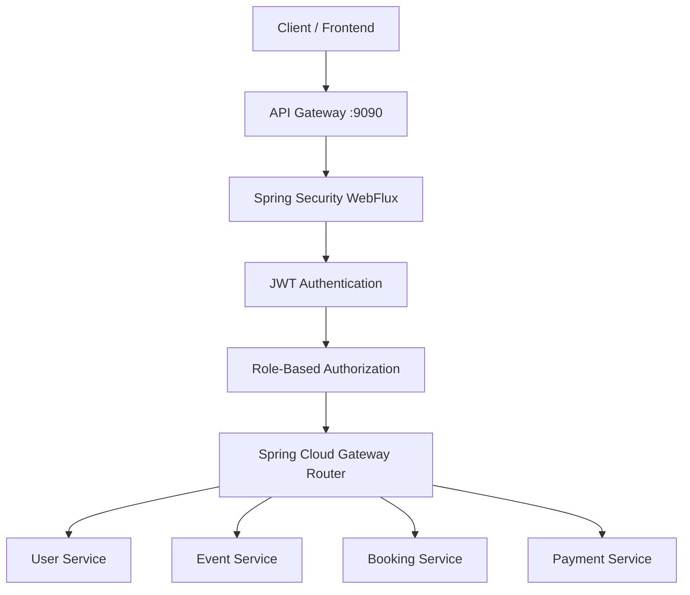
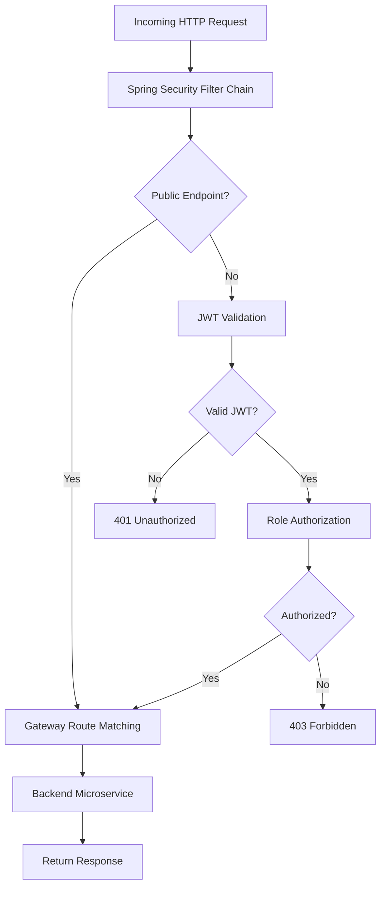
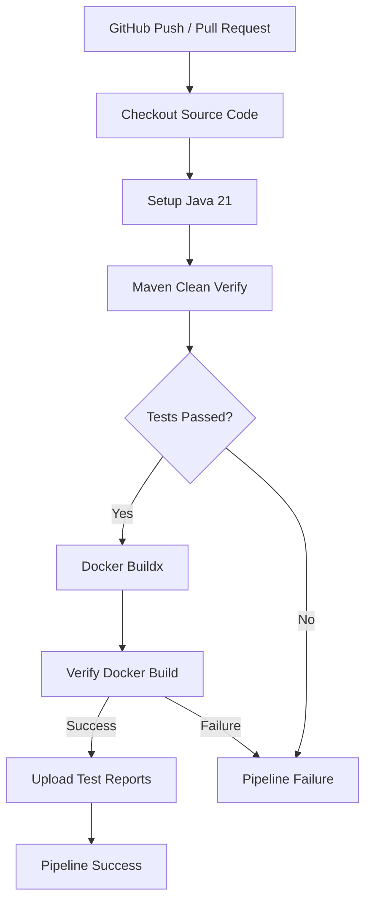

# API Gateway - Architecture

## Overview

The API Gateway serves as the centralized entry point for all client requests in the Event Ticketing System.

Built using Spring Cloud Gateway and Spring WebFlux, it provides reactive request routing, JWT-based authentication, role-based authorization, and centralized security enforcement across the microservices architecture.

The gateway validates incoming requests before forwarding authorized traffic to the appropriate backend services.

## Responsibilities

- **Centralized API Entry Point** – Provides a single entry point for frontend and external clients.
- **Request Routing** – Routes incoming requests to the appropriate microservices.
- **JWT Authentication** – Validates JWT signatures, expiration, and token claims.
- **Role-Based Access Control (RBAC)** – Restricts access to protected endpoints based on user roles.
- **Centralized Security** – Enforces authentication and authorization using Spring Security WebFlux.
- **CORS Configuration** – Controls cross-origin requests from authorized frontend origins.
- **Environment-Based Configuration** – Supports configurable service URLs, ports, and JWT secrets.
- **Request Management** – Configures downstream connection and response timeouts.
- **Health Monitoring** – Exposes Spring Boot Actuator health endpoints.
- **Containerization** – Supports deployment using a Multi-Stage Dockerfile.
- **Continuous Integration** – Automates testing and Docker build verification using GitHub Actions.

## Tech Stack

| Technology | Version / Details |
|---|---|
| Java | 21 |
| Spring Boot | 3.3.4 |
| Spring Cloud | 2023.0.3 |
| Spring Cloud Gateway | Reactive API Gateway |
| Spring WebFlux | Reactive Web Framework |
| Spring Security | Authentication and Authorization |
| OAuth2 Resource Server | JWT Validation |
| Nimbus JOSE + JWT | HS256 JWT Decoding |
| dotenv-java | 3.0.0 |
| Maven | Build Tool |
| JUnit 5 | Unit and Integration Testing |
| Mockito | Mocking |
| MockWebServer | Downstream Routing Tests |
| Reactor Test | Reactive Testing |
| Docker | Multi-Stage Container Build |
| GitHub Actions | CI Pipeline |

## Dependencies

The API Gateway uses the following main dependencies:

- `spring-cloud-starter-gateway`
- `spring-boot-starter-security`
- `spring-boot-starter-oauth2-resource-server`
- `spring-boot-starter-actuator`
- `dotenv-java`
- `spring-boot-starter-test`
- `spring-security-test`
- `reactor-test`

Additional testing utilities include MockWebServer for verifying gateway routing behavior.

## Architecture



The API Gateway acts as a reverse proxy and routes requests to backend services after applying configured security rules.

Backend services remain responsible for enforcing their own domain-level authorization and business rules.

## Request Processing Flow

The API Gateway processes incoming requests through the following steps:

1. The client sends an HTTP request to the API Gateway.
2. Spring Security evaluates the request against configured security rules.
3. Public endpoints are permitted without authentication.
4. Protected endpoints require a valid JWT access token.
5. The JWT decoder validates the token signature and expiration.
6. The JWT authentication converter extracts the user identity and roles.
7. Role-based authorization determines whether the request is permitted.
8. Authorized requests are forwarded to the matching backend service.
9. The backend service processes the request and returns a response through the gateway.



## JWT Authentication

The API Gateway uses Spring Security OAuth2 Resource Server to validate JWT access tokens.

### JWT Configuration

- **Algorithm:** HS256
- **Token Format:** Bearer Token
- **Signing Secret:** Shared with the authentication service
- **Principal:** User ID from the JWT subject claim
- **Roles:** Extracted from the JWT `roles` claim

Example JWT payload:

```json
{
  "sub": "550e8400-e29b-41d4-a716-446655440000",
  "roles": ["ROLE_USER"],
  "iat": 1760000000,
  "exp": 1760086400
}
```

The payload above is an illustrative example.

### JWT Validation

The gateway validates:

- JWT signature
- Token expiration
- Supported signing algorithm
- Required token claims

The JWT decoder uses a Base64-encoded secret key with a minimum decoded length of 256 bits for HS256.

### Authentication Converter

The custom `JwtAuthenticationConverter` maps:

- `sub` → Authenticated principal
- `roles` → Spring Security `GrantedAuthority`

This allows Spring Security to enforce role-based authorization using the roles included in the token.

## Role-Based Access Control (RBAC)

The API Gateway supports three application roles:

| Role | Description |
|---|---|
| `ROLE_USER` | Regular authenticated user |
| `ROLE_ORGANIZER` | Event organizer |
| `ROLE_ADMIN` | System administrator |

### API Authorization Rules

| HTTP Method | Endpoint | Access |
|---|---|---|
| POST | `/api/v1/user/visitor/register` | Public |
| POST | `/api/v1/user/visitor/login` | Public |
| GET | `/api/v1/events` | Public |
| GET | `/api/v1/events/**` | Public |
| POST | `/api/v1/events` | ORGANIZER |
| PUT | `/api/v1/events/{id}` | ORGANIZER |
| DELETE | `/api/v1/events/{id}` | ORGANIZER |
| POST | `/api/v1/bookings` | USER, ADMIN |
| GET | `/api/v1/bookings/my-bookings` | USER, ADMIN |
| GET | `/api/v1/bookings` | ADMIN |
| GET | `/api/v1/bookings/{id}` | USER, ADMIN |
| PATCH | `/api/v1/bookings/{id}/cancel` | USER, ADMIN |
| GET | `/actuator/health` | Public |

The table reflects the configured gateway authorization design. The cancellation endpoint assumes the standardized `/cancel` mapping is used consistently across the gateway and Booking Service.

### Default Security Policy

The gateway follows a deny-by-default authorization strategy.

Requests that do not match an explicitly permitted security rule are rejected.

### HTTP Security Responses

| HTTP Status | Meaning |
|---|---|
| 200 OK | Successful request |
| 201 Created | Resource created successfully |
| 400 Bad Request | Invalid request |
| 401 Unauthorized | Missing or invalid authentication |
| 403 Forbidden | Access denied |
| 404 Not Found | Requested resource or route not found |

The actual status returned also depends on backend behavior and gateway configuration.

## Gateway Routing

Spring Cloud Gateway routes requests based on configured path predicates.

### Route Mapping

| Route | Path Predicate | Backend |
|---|---|---|
| User Service | `/api/v1/user/**` | User Service |
| Event Service | `/api/v1/events/**` | Event Service |
| Booking Service | `/api/v1/bookings/**` | Booking Service |
| Payment Service | `/api/v1/payments/**` | Payment Service |

Payment Service routing is part of the overall system architecture and must be configured in the gateway before it is available.

### Local Development Ports

| Service | Port |
|---|---|
| API Gateway | 9090 |
| User Service | 8081 |
| Event Service | 8082 |
| Booking Service | 8083 |
| Payment Service | Event-Driven |

All external API requests should be sent through the API Gateway.

Example:

```http
GET http://localhost:9090/api/v1/events
```

The gateway forwards the request to the configured Event Service.

## CORS Configuration

The API Gateway supports cross-origin requests from configured frontend applications.

### Allowed Origins

```text
http://localhost:3000
http://localhost:5173
```

### Allowed HTTP Methods

- GET
- POST
- PUT
- PATCH
- DELETE
- OPTIONS

The configuration permits the required request headers and handles CORS preflight requests.

Production environments should explicitly configure trusted frontend origins.

## HTTP Client Configuration

The gateway configures downstream HTTP client timeouts.

| Configuration | Value |
|---|---|
| Connection Timeout | 5000 ms |
| Response Timeout | 10 seconds |

These settings help prevent downstream connection attempts and responses from waiting indefinitely.

## Health Monitoring

Spring Boot Actuator exposes the gateway health endpoint.

### Endpoint

```http
GET http://localhost:9090/actuator/health
```

### Expected Response

```json
{
  "status": "UP"
}
```

The health endpoint is publicly accessible.

A successful gateway health check confirms the gateway application's health status, but does not guarantee that every downstream microservice is available.

## Testing Strategy

The API Gateway includes automated tests for security, routing, JWT validation, and application configuration.

### Unit Tests

- JWT decoder configuration tests
- JWT authentication converter tests
- JWT role mapping tests
- Invalid JWT configuration tests

### Integration Tests

- Gateway security integration tests
- Role-based authorization tests
- Public endpoint access tests
- Unauthorized request tests
- Forbidden request tests
- Gateway routing integration tests
- Downstream request forwarding tests

### Test Classes

| Test Class | Responsibility |
|---|---|
| `GatewaySecurityIntegrationTest` | Authentication and authorization |
| `GatewayRoutingIntegrationTest` | Downstream routing |
| `GatewayRoutesConfigTest` | Route configuration |
| `JwtDecoderConfigurationTest` | JWT decoder configuration |
| `JwtAuthenticationConverterTest` | JWT principal and role mapping |
| `ApiGatewayServiceApplicationTests` | Spring application context |

### Run Tests

```bash
./mvnw clean verify
```

The Maven build fails if required tests fail.

### Test Profile

The project uses a dedicated `test` Spring profile for automated testing.

```yaml
spring:
  profiles:
    active: test
```

The test profile can be activated through the `SPRING_PROFILES_ACTIVE` environment variable.

## Docker Containerization

The API Gateway supports a Multi-Stage Docker build.

### Stage 1 — Build

- Uses Maven with Java 21.
- Downloads project dependencies.
- Compiles the application.
- Packages the Spring Boot executable JAR.

### Stage 2 — Runtime

- Uses Java 21 JRE.
- Copies the executable JAR from the build stage.
- Runs the application using a non-root user.
- Exposes port `9090`.

### Build Docker Image

```bash
docker build -t event-ticketing-api-gateway:1.0.0 .
```

### Run Docker Container

```bash
docker run -d \
  --name api-gateway \
  -p 9090:9090 \
  --env-file .env \
  event-ticketing-api-gateway:1.0.0
```

The environment must provide the required JWT secret and reachable downstream service URLs.

When running inside Docker, `localhost` refers to the container itself. Downstream services should be addressed using Docker network service names or another reachable network address.

### Verify Container

```bash
docker logs -f api-gateway
```

```bash
curl http://localhost:9090/actuator/health
```

## CI Pipeline

GitHub Actions automates build verification, unit testing, integration testing, and Docker image build validation.

### Workflow Triggers

The pipeline runs on:

- Pushes to the `develop` branch.
- Pull requests targeting `develop`.
- Pull requests targeting `main`.

### CI Pipeline Steps

1. Checkout source code.
2. Configure Java 21.
3. Cache Maven dependencies.
4. Run unit and integration tests.
5. Configure Docker Buildx.
6. Verify the Multi-Stage Docker build.
7. Upload test reports.



The CI workflow verifies the Docker image build without pushing the image to a container registry.

Test reports are uploaded for debugging and troubleshooting.

## Environment Configuration

The API Gateway supports environment-based configuration.

Important configuration values include:

| Variable | Purpose |
|---|---|
| `SERVER_PORT` | Gateway HTTP port |
| `SPRING_PROFILES_ACTIVE` | Active Spring profile |
| `JWT_SECRET` | JWT verification secret |
| `USER_SERVICE_URL` | User Service address |
| `EVENT_SERVICE_URL` | Event Service address |
| `BOOKING_SERVICE_URL` | Booking Service address |

The corresponding Spring configuration properties must reference these environment variables for overrides to take effect.

Sensitive configuration values must not be committed to source control.

## Security Best Practices

- Validate JWT signatures and expiration.
- Enforce role-based authorization.
- Apply deny-by-default security rules.
- Disable unused authentication mechanisms.
- Keep JWT secrets outside source control.
- Use HTTPS in production.
- Run Docker containers as non-root users.
- Validate backend resource ownership independently of gateway authorization.
- Restrict CORS origins in production.
- Apply request timeouts for downstream services.
- Maintain automated security and routing tests.
- Use Kubernetes Secrets or a dedicated secrets manager for production credentials.

## Future Improvements

- Kubernetes-native service discovery using Services and DNS.
- Kubernetes Deployment and Service manifests.
- Liveness and readiness probes.
- Centralized logging and distributed tracing.
- Request correlation IDs.
- Rate limiting.
- Resilience and circuit-breaker policies.
- Container registry publishing.
- Continuous Deployment using GitOps and Argo CD.

## Conclusion

The API Gateway provides centralized routing, authentication, and authorization for the Event Ticketing System.

Its reactive architecture, JWT-based security, automated testing, Multi-Stage Docker build, and GitHub Actions CI pipeline establish a foundation for deploying and operating the microservices system in containerized environments.